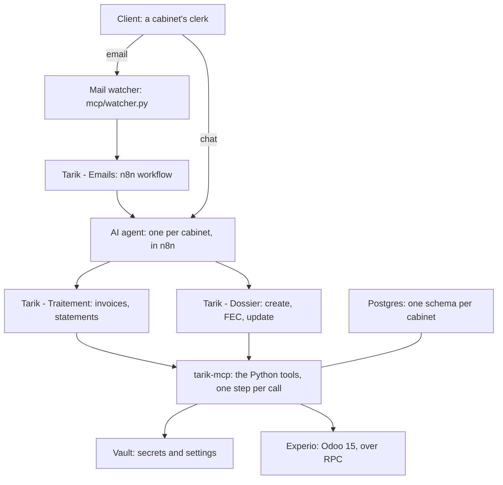

# Tarik repository guide

For a developer joining the project: what Tarik is, every file and folder of the repository and what it is for,
and the day-to-day loop. The [README](../README.md) is the reference; this is the tour.

## What Tarik is

Tarik is an accounting assistant for Moroccan cabinets (accounting firms) using Experio, an Odoo 15 app. A clerk
writes to Tarik by chat or email, attaches invoices, bank statements or a FEC, and Tarik puts them into Experio
through Experio's own screens and wizards. Nothing is invented: a model (MiniMax-M3) only reads scans and the
client's words; every write is a fixed Python step.

The pieces, each a Docker service in `docker-compose.yml`:

- **n8n** (patched, `n8n/`): hosts one native agent per cabinet ("Tarik - GECAFISC" and 7 more) and three
  workflows. The agent finds the dossier and hands the work to a workflow; the workflow calls the Python tools step
  by step.
- **tarik-mcp** (`mcp/`): the Python tools, served over MCP at `http://tarik-mcp:8000/c/<cabinet>/mcp`. One address
  per cabinet, so a call can only ever work in the cabinet it named.
- **tarik-mail-watch** (`mcp/watcher.py`, same image): watches each cabinet's mailbox over IMAP IDLE and wakes the
  email workflow.
- **postgres**: Tarik's own data (one schema per cabinet, from `mcp/tarik/core/cabinet.sql`) and n8n's data.
- **vault**: every secret and per-cabinet setting (`secret/tarik/shared`, `secret/tarik/cabinets/<cabinet>`). The
  cabinets are those Vault paths.

A cabinet is named by its exact Experio database (`experio_cabinet_8`). That name is its MCP address, its Vault
path and its Postgres schema. The agent never sees Odoo, a URL or a setting: it is "Experio" everywhere.

A request flows like this: an email arrives, the watcher stores it and wakes "Tarik - Emails"; that workflow asks
the cabinet's agent; the agent calls "Tarik - Traitement" (invoices and statements) or "Tarik - Dossier" (a new
dossier, a FEC, or a change to a dossier); each node of those workflows is one MCP tool in `mcp/tarik/`; the run's
summary comes back to the agent, then to the client. Chat follows the same path without the watcher and the email
workflow.

The agent only chooses which workflow to call and fills a few fields; each workflow node is one Python tool, and
only those tools write to Experio. Postgres also holds n8n's own data.

## Repository layout

Everything at the root, and what each entry is for.

| Entry | What it is |
| --- | --- |
| `README.md` | The reference: how it is built, the rules the tools keep, cabinets and Vault, setup, deploy, tests. Read it first. |
| `docker-compose.yml` | The five services above. `tarik-mcp` gets only the variables Tarik reads, never the whole `.env`. |
| `.env` / `.env.example` | Host settings: Postgres names and password, `ODOO_URL`, n8n's encryption key, `N8N_MCP_API_URL`. `.env` is ignored by git; copy the example. |
| `pyproject.toml` | Ruff's formatter and linter settings: Python 3.14, 120 columns. A style test enforces them on every Python file. |
| `.gitignore` | `.env`, `vault/.local/` (unseal key, root token, AppRole ids), `.temp/`, caches. |
| `mcp/` | The Python side: the MCP server, the mail watcher, the `tarik` package and its tests. Built into the `tarik-mcp` image. |
| `workflows/` | The n8n workflows as JSON, the Python builders that generate them, and the agent template. |
| `instructions/` | Everything the model is told: the agents' skills and the prompts the tools send. |
| `n8n/` | The n8n image: a Dockerfile and `patch.js`, which edits a few lines of n8n at build time. |
| `vault/` | Vault's config and the two scripts that start, unseal and set it up locally. |
| `docs/` | Three Markdown docs, this guide, and a generated HTML/PDF overview of the workflows for the project team. |
| `.claude/`, `.temp/` | Local tooling and scratch; not part of the project. |

## mcp/: the Python tools

Every tool is a Python function decorated with `@server.tool()` (or `@step_tool`, which also copies the invoice,
file and dossier ids into the result so n8n can route on them). Importing a module registers its tools. A tool
returns a dict with `status` (`ok`, `wait`, `question`, `stop`) and a French `message` the client reads; a
`ToolError` is the only text that reaches the agent on failure.

**Entry points and packaging**

| File | Role |
| --- | --- |
| `mcp/server.py` | The ASGI app: routes `/c/<cabinet>/mcp` to the MCP server inside `cabinets.using(name)`, with a semaphore per cabinet and one for the whole server. At start it refuses to run unless Vault is set, every cabinet logs into Experio with the expected user id, and each schema exists. |
| `mcp/watcher.py` | `tarik-mail-watch`: one IMAP IDLE thread and one 15-minute tick thread per cabinet mailbox. Stores new emails, tells the manager of refused senders, and posts to the "Tarik - Emails" webhook with a shared secret header. |
| `mcp/Dockerfile`, `.dockerignore`, `pytest.ini` | Python 3.14 slim with pinned dependencies (mcp, psycopg, pillow, pypdfium2, httpx, openpyxl, pytest, ruff). `pytest.ini` declares the test categories as markers and excludes `live` and `llm` by default. |

**`tarik/core/`: what every tool builds on**

| Module | Role |
| --- | --- |
| `app.py` | The `MCPServer` instance, `log()`, the result makers `ok`/`wait`/`question`/`stop`/`routine`, and the `with_ids` and `step_tool` decorators. |
| `config.py` | Constants shared by all cabinets: `ODOO_URL`, Postgres, timeouts, Experio's state codes, the dossier domain, name-matching thresholds, PDF rendering settings. |
| `cabinets.py` | The Vault client (AppRole login, settings re-read every 5 minutes, last values kept on an outage), the list of cabinets, `current()` and `using()` (a context variable holding the call's cabinet), `setting(key)` which refuses a key in the wrong place, `cabinet_db()` (a Postgres connection whose search_path is that cabinet's schema only), and `create_schemas()`. |
| `cabinet.sql` | One cabinet's tables, idempotent: `tarik_files`, `tarik_checks`, `tarik_classifications`, `tarik_results`, `tarik_pending`, `tarik_setups`, the mail tables, `tarik_client_messages`. Columns added later use `alter table ... add column if not exists`. |
| `experio.py` | Experio calls and guards: XML-RPC (`odoo_call`, one proxy per thread) and JSON-RPC (`odoo_json`, for answers holding None), login checked against `ODOO_UID`, `dry_run()` and `TEST_MODE`, the `refused()` context manager that turns any failure into a French ToolError, `require_dossier`, `require_invoice`, `require_draft_invoice`, `fill_invoice` (types fields into the form one by one so Experio's onchanges run), `refresh`, `experio_notes`, and the `experio_connection` tool. |
| `model.py` | The vision model over the Anthropic message format MiniMax imitates: `ask_model`, `json_answer` (the one JSON object in a reply), `instruction(name)` reading `instructions/tools/<name>.md`, and the PDF page rendering (`pdf_pages`, `scan_pages`, `to_pdf`). |
| `words.py` | Reading what people write: `normalized`, `said`, `similarity`, `ranked`, `strip_tags`, `ICE_WRITTEN`, and numbers in French or American style (`readings`, `as_number`, `written_numbers`). |
| `conversation.py` | The client's own words per conversation (`client_messages`, `own_words`), `yes_no` and `chosen_among`: a choice is read from the agent's decision, never guessed. |

**`tarik/dossiers/`: dossiers and people**

| Module | Tools |
| --- | --- |
| `search.py` | `list_dossiers`, `find_dossier` (fuzzy name match, 5 closest with a score). |
| `people.py` | `list_collaborators`, `check_sender`: an email's sender must be a collaborator or Experio staff with the dossier assigned. |
| `identity.py` | `create_dossier`, `update_dossier`: identity fields only to values the client wrote themselves, duplicates by ICE, IF or name refused, confirmation questions before skipping the registry check. |
| `setup.py` | `copy_configuration`, `import_entries` (FEC or grand livre through Experio's import screen), `finish_setup` (walks the onboarding stepper, waits for lines to be a minute old), `setup_status`, `waiting_setups`. |

**`tarik/invoices/`: the fixed sequence, one module per step**

| Module | Tools |
| --- | --- |
| `intake.py` | `identify_document`, `split_invoices` (one PDF into several), `create_draft_invoice`, `import_bank_statement`. Rows are locked `for update` so a retry never creates a second draft. |
| `classify.py` | `classify_invoice`: achat, vente or bank statement; also `side_of` and `client_side` used by other steps. |
| `check.py` | `check_invoice`: the model reads the scan and compares with what Experio captured; dates resolved in code; false alarms dropped. Stores the report in `tarik_checks`. |
| `correct.py` | `correct_invoice`: writes the differences back, plus credit note, multi-TVA split, currency, payment method. |
| `tiers.py` | `link_tiers`, `find_tiers`, `choose_tiers`: the supplier or customer, Experio's detection first, else a question listing close names. |
| `duplicates.py` | `check_duplicate`: Experio's own check against posted invoices and the dossier's other drafts. |
| `accounts.py` | `assign_account`, `set_account`: the memorized account, else the model picks among the dossier's real chart, else a question. |
| `tva.py` | `settle_tva`: recoverable or not (a question on fuel, travel and car accounts), the cabinet's prorata, Experio's tax lines. |
| `journal.py` | `check_journal`: the journal Experio's rule gives, or which dossier setting is missing. |
| `withholding.py` | `settle_withholding`: retenue à la source, the tiers' known rule or a question read by the model. |
| `prepaid.py` | `settle_prepaid`: charges constatées d'avance when the billed period spans months. |
| `exercice.py` | `settle_exercice`: the fiscal year, relinking, late invoices, or opening a new year. |
| `posting.py` | `post_invoice`: only when Experio's own validation is clear; state read back. |
| `listing.py` | `list_invoices`: a dossier's invoices by status, for the agent. |
| `pipeline.py` | The run's bookkeeping, used by n8n rather than the agent: `wait_until_read`, `record_step`, `run_summary`, `answer_pending`, `save_files`, `files_to_process`, `waiting_drafts`. `STEPS` is the sequence in order. |

**`tarik/emails/`: the mailbox**

| Module | Role |
| --- | --- |
| `inbox.py` | Reads IMAP without changing it, threads emails by `In-Reply-To` and `References`, refuses non-collaborators and auto-replies, and the thread tools the email workflow calls: `claim_threads`, `acknowledge_thread`, `thread_refusal`, `notify_manager`, `finish_thread`. |
| `sending.py` | `send_email`: whitelist only (`MAIL_ALLOWED_RECIPIENTS`), pinned certificate, Markdown rendered to text and HTML, a copy saved in Sent. |
| `agent.py` | `ask_agent`: asks the cabinet's n8n agent through n8n's MCP `call_agent`, in the thread's own conversation. |

## mcp/tests/: the tests

Tests run in a throwaway `tarik-mcp` container on your working copy, against the test database `tarik_test`
(never the cabinets' own) with settings from the environment instead of Vault. Each test has one category
marker: `security`, `functionality`, `communication`, `technical`, `style`, plus `live` (the real n8n) and `llm`
(the real model, slow, billed), which only run when asked.

| File or folder | Role |
| --- | --- |
| `run.py` | The runner. `python3 mcp/tests/run.py` runs the tests covering the files changed since the last commit (it follows imports); `--all` runs everything; `-m llm` a category. Any other argument goes to pytest. |
| `conftest.py`, `testdb.py`, `fakes.py` | The test database and a throwaway cabinet schema per run (`db_cabinet` fixture, emptied around each test); `FakeDb` and `flag` stand-ins. |
| `runs.py` | A realistic ten-invoice run, recorded as n8n records it, for the summary tests. |
| `core/` | Experio guards and the proxy cache (`test_experio.py`), Vault against a fake server (`test_vault.py`), the test database itself. |
| `dossiers/` | Search, people, dossier creation and update rules, onboarding, the setup wait. |
| `invoices/` | One file per step (`test_check.py`, `test_tiers.py`, `test_duplicates.py`, `test_tva.py` ...), the answer routing (`test_answers.py`), the summary, the files. `replies/` holds real model replies that once broke the JSON reader. |
| `emails/` | Threads, inbox reading, sending and whitelist, the agent call, the watcher. |
| `isolation/` | The security suite: one cabinet never sees another's schema, settings or HTTP address, and no tool ever shows a setting, whatever Experio, the mailbox or the model do (`test_no_setting_shown.py` calls every tool). |
| `style/` | Ruff lint and format on every Python file, each workflow JSON equal to what its builder produces, every tool a workflow or skill names exists, every caller fills every workflow input, each prompt file read by the tool it names. |
| `n8n/` | Live: the agent's memory and conversation, and `test_at_the_end.py` which runs "Tarik - Test Merge" to check n8n's execution order after an upgrade. |
| `llm/` | Live, measured on many replies: `test_decisions.py` (what the agent reads as oui/non, which tiers, exercice or bank account the client chose) and `test_relay.py` (every fact of a summary reaches the client). |

## workflows/: n8n

The JSON files are generated. Edit a builder, run it, then import and publish the JSON (README). A style test
fails when a JSON differs from what its builder produces.

| File | Role |
| --- | --- |
| `steps.py` | What the builders share: the `Workflow` class (nodes, connections, an MCP step with its cabinet address, a router, a code node, `record_and_summary`, `at_the_end`), and the input lists `TRAITEMENT_INPUTS` and `DOSSIER_INPUTS` every caller must fill. |
| `build_tarik_traitement.py` / `tarik-traitement.json` | "Tarik - Traitement" (`TarikTraitement1`): the invoice sequence, one node per step, each only when the previous said ok. Modes `files` (new files), `answer` (the client's answer, resumed at the right step), `resume` (drafts Experio was still reading, no agent). A 240-second budget: invoices still going wait for the next run. |
| `build_tarik_dossier.py` / `tarik-dossier.json` | "Tarik - Dossier" (`TarikDossier0001`): create, copy a model's configuration, import each FEC, finish the onboarding, report the state. Mode `update` changes an existing dossier's identity fields instead. Mode `resume` finishes dossiers left waiting. |
| `build_tarik_emails.py` / `tarik-emails.json` | "Tarik - Emails" (`TarikEmails00001`): a webhook woken by the watcher; claims the waiting threads, acknowledges a new one, asks the cabinet's agent, sends the reply; a follow-up runs Traitement then Dossier in mode resume and emails both summaries. |
| `build_tarik_merge_test.py` / `tarik-merge-test.json` | "Tarik - Test Merge": only for `tests/n8n/test_at_the_end.py`, which checks n8n still runs the summary node last after an upgrade. |
| `tarik-agent.json` | The agent template: instructions, the five read-only MCP tools, and four workflow tools (`Experio_traiter_fichiers`, `Experio_repondre`, `Experio_parametrer_dossier`, `Experio_modifier_dossier`) with their fixed and model-filled inputs. `__CABINET__` and `__CABINET_NAME__` are replaced per cabinet. |
| `build_tarik_agents.py` | Creates or updates every cabinet's agent from the template and the skills, through n8n's MCP server. The cabinets are listed in its `CABINETS` dict. It refuses to build when a skill names a tool the agents do not have. Prints each `AGENT_ID` for Vault. |
| `layout.json` / `save_layout.py` | Node positions as arranged in n8n's editor, read from n8n's database by the script and applied by the builders, so a rebuild keeps the layout. |

## instructions/, n8n/, vault/, docs/

**`instructions/`: what the model is told, written once**

| File | Role |
| --- | --- |
| `skills/nouveau-dossier.md`, `traitement-documents.md`, `modification-dossier.md`, `reponse-question.md` | The agents' four skills (front matter `name`, `description`, then the instructions, in French). `build_tarik_agents.py` gives every agent the same copy and removes a skill from all agents when its file goes. They name tools exactly as the model sees them (`Experio_find_dossier`). |
| `tools/check-invoice.md`, `check-invoice-answer.md` | What `check_invoice` tells the model: how to read a Moroccan invoice, and the JSON shape to answer with. |
| `tools/classify-document.md` | Achat, vente or releve bancaire, for `identify_document` and `classify_invoice`. |
| `tools/split-pdf.md` | Which pages begin a new invoice, for `split_invoices`. |
| `tools/choose-account.md` | The CGNC accounts and the rules, for `assign_account`. |

Each prompt file starts with front matter `used_by`; a style test checks it is read by that tool. The container
mounts the folder, so a prompt change applies on restart with no rebuild. Short answer shapes (a few lines) live
as constants next to the code that reads the answer.

**`n8n/`: the patched n8n image**

| File | Role |
| --- | --- |
| `Dockerfile` | n8n 2.43.5 plus the patch. |
| `patch.js` | Edits n8n's own source at build time: an agent's workflow tool may run `TARIK_AGENT_TOOL_TIMEOUT_MS` (5 minutes, n8n's fixed value is 2); a tool input fixed to `{{threadId}}`, `{{attachments}}` or `{{clientMessage}}` is filled by n8n with the conversation's id, its files and the client's latest message word for word, never by the model; `call_agent` accepts `newSession`. The build fails if an n8n upgrade moves a patched line. |

**`vault/`: secrets, local setup**

| File | Role |
| --- | --- |
| `config.hcl` | Vault's file storage config. |
| `start.sh` | The container's entrypoint: starts Vault and unseals it with the key kept in `vault/.local/unseal/`. |
| `setup.sh` | Run once: creates the KV mount, the policy that only reads `secret/tarik/*`, and the AppRole whose `role_id` and `secret_id` are written to `vault/.local/approle/` and mounted read-only into `tarik-mcp`. |

`vault/.local/` is git-ignored: unseal key, root token and AppRole ids live on the machine only. On the public
server a real Vault takes this container's place.

**`docs/`: documentation**

| File | Role |
| --- | --- |
| `architecture.md` | The system diagram, the trust rules (what the model may decide, what only the client's words may set), the data each service keeps. |
| `tools-and-workflows.md` | Every tool, skill and workflow in one table each, and the scripts. |
| `using-tarik.md` | For the cabinet: what Tarik can do and how to write to it. |
| `repository-guide.md` | This guide; `workflows-overview/build.py` renders it to `guide.html` and `guide.pdf`. |
| `workflows-overview/build.py`, `overview.html` | A generated site for the project team: `index.html` from the hand-written `overview.html`, one page per workflow with a map drawn from the JSON and every node explained, this guide, then PDFs with Chrome and `pdfunite`. The generated `.html` and `.pdf` files are committed. Run it after a workflow changes; it fails when a node has no explanation. |

## Day to day

**Rules the code keeps, and tests enforce**

- Every dossier tool needs a real dossier id from `find_dossier`; every invoice tool a real draft of one of the
  cabinet's dossiers.
- The model never decides a value: an ICE, an amount, a name is taken only when the client wrote it; a choice only
  among what the question proposed.
- `DRY_RUN=1` per cabinet (the default): drafts and statements are created, nothing else is written; replies start
  with `MODE TEST`.
- A setting is either the cabinet's own or shared, never both, and never shown to the agent.
- One module per invoice step; a step tells the client what it did in one French sentence; routine outcomes are
  left out of the summary.

**Changing Python**

1. Edit a module under `mcp/tarik/`.
2. `python3 mcp/tests/run.py` runs the tests that cover your change; `--all` for everything. Ruff lint and format
   are part of the style tests.
3. `docker compose up -d --build --force-recreate tarik-mcp tarik-mail-watch`.

**Changing a workflow or the agents**

1. Edit `workflows/build_tarik_*.py` or `workflows/steps.py`, run the builder.
2. `docker compose cp` the JSON into n8n, `n8n import:workflow`, `n8n publish:workflow --id=...`,
   `docker compose restart n8n` (README has the exact commands).
3. A change to `tarik-agent.json` or a skill: `python3 workflows/build_tarik_agents.py`. It updates all cabinets
   and republishes the agents that were published.
4. `python3 docs/workflows-overview/build.py` to regenerate the team overview.

**Changing a prompt**: edit `instructions/tools/*.md`, restart `tarik-mcp`.

**Adding a cabinet**: give Tarik a user in that cabinet's Experio, add its database name to `CABINETS` in
`build_tarik_agents.py`, run it, put the agent id and the cabinet's settings in Vault under
`secret/tarik/cabinets/<cabinet>`, restart `tarik-mcp` (its schema is made at start).

**Where to look when something goes wrong**: `docker compose logs tarik-mcp` (every Experio refusal is logged with
the tool and the invoice), the run's rows in `tarik_results`, the thread's state in `tarik_mail_threads`, and n8n's
execution of the workflow.
